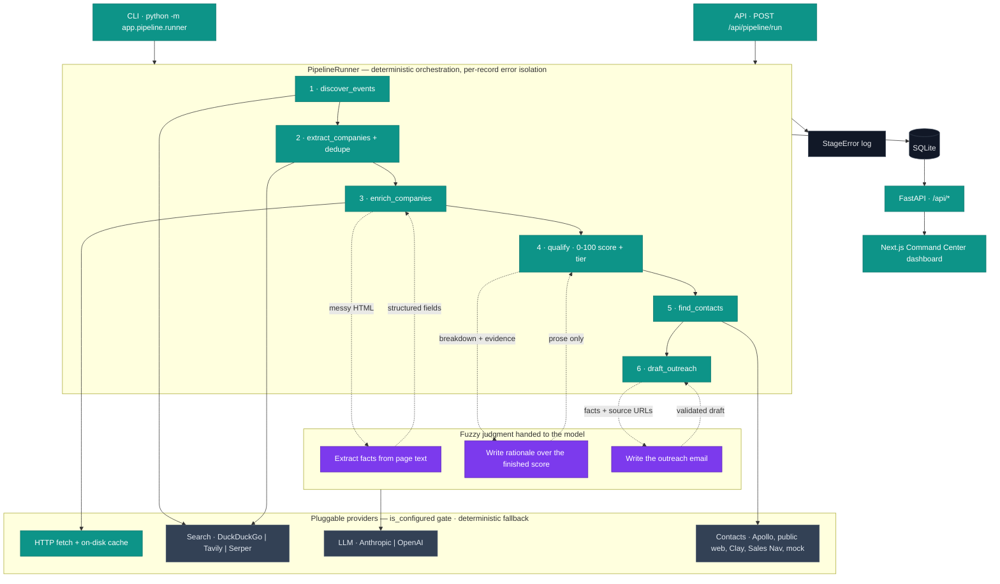

# Tedlar Lead Agent

An end-to-end **lead generation and outreach agent** for **DuPont Tedlar — Graphics & Signage**.
It finds the events and associations where Tedlar's ideal customers gather, sources the
companies exhibiting there, enriches each one from its own website, scores it transparently
against the ICP, identifies the decision-makers, and drafts an evidence-grounded first email —
then serves the whole result set through an operator dashboard a sales rep can actually work from.

Built as a case study for **InstaLILY**.

---

## The one idea to take away

> **Deterministic orchestration; the LLM is confined to fuzzy judgment.**

Everything that must be correct and reproducible — sourcing, deduplication, the 0–100 score,
retries, persistence, filtering, provider selection — is plain, testable Python. The model is
called in exactly three places, and only for work that is genuinely about reading or writing
messy natural language:

1. turning a company's crawled web page into structured facts,
2. writing the *rationale* over a score the code already computed,
3. writing the outreach email over facts the pipeline already verified.

The model never produces a number, never decides a tier, and never invents a fact. That boundary
is what makes the output **arguable and reproducible** rather than merely plausible — and it is
the thread running through every design decision below.

---

## Architecture



**Reading the diagram** — teal is deterministic Python, purple is the LLM, slate is a swappable
external provider, dark is storage. The six stages run in sequence inside one `PipelineRunner`;
each stage does its own work in code and *reaches out* to the model only along the dashed edges.
Providers are all interchangeable and every one has a fallback, so the pipeline completes even
with an empty `.env`.

---

## How it works, stage by stage

Every stage takes a typed input and returns a typed output. A single record that fails gets a
`StageError` row and `status="incomplete"`, and the run keeps going. **Partial success is the
normal outcome — a crash is a bug.** The per-record isolation lives in
`backend/app/pipeline/context.py` (`ctx.attempt` / `ctx.guard`).

| # | Stage | What the code decides | What the model does |
|---|---|---|---|
| 1 | **discover_events** | Which institutions to verify; event vs. listicle; one event per host | — |
| 2 | **extract_companies** | Three sourcing channels (below); dedupe by registrable domain, then fuzzy legal-name match ≥ 0.90 | — |
| 3 | **enrich_companies** | Which pages to crawl, in what order; whether a size figure is trustworthy | Reads crawled text into structured fields |
| 4 | **qualify** | The entire 0–100 score, confidence, and tier | Writes the rationale over a finished breakdown |
| 5 | **find_contacts** | Provider waterfall order; employer verification; ranking by *function*, not just seniority | — |
| 6 | **draft_outreach** | Which evidence is the strongest hook; whether a draft is allowed to ship | Writes the email |

Company sourcing (stage 2) runs **three independent channels**, because each fails differently:

1. **Exhibitor-directory scrape** — works on plain-HTML directories.
2. **ICP-shaped search** — the channel that scales; a new vertical is just new query templates.
3. **Verified ICP roster** — names and public URLs only; the pipeline still fetches every site
   and derives every fact from what it reads. The one hand-curated input, and deliberately the
   cheapest part to delete.

---

## Lead scoring

A transparent 0–100 score in `backend/app/scoring/score.py`, with the ICP itself living **as
data** in `backend/app/scoring/icp.py` (retargeting to another business unit or client is a
config edit, not a code change).

| Component | Max | What earns it |
|---|---:|---|
| Industry fit | 30 | Tiered ICP vocabulary in the company's own positioning (tier-1: signage, graphic films, vehicle wrap; tier-2: commercial printing, outdoor advertising) |
| Application fit | 25 | Tedlar application areas — outdoor signage, fleet/transit graphics, architectural graphics, overlaminates |
| Company size | 15 | Revenue bands, falling back to headcount bands |
| Event engagement | 15 | Named on an exhibitor directory, or the company's own site says it exhibits |
| Pain-point alignment | 15 | Already markets on UV / weather / graffiti / chemical resistance, cleanability, graphic lifespan |

**Tiers:** A ≥ 75 · B ≥ 60 · C ≥ 40 · below that, disqualified.

**The model never produces the number.** It receives the finished breakdown and the evidence
list and writes prose. Two guards then run over what it wrote:

- every URL it cites must be one the pipeline supplied, or the record is flagged `cited_unknown_source`;
- any sentence making a numeric claim that can't be matched to a known figure is removed and the
  record flagged `unsupported_claim_removed`.

`confidence` is the share of scoring components backed by a source URL, penalised for a missing
website, missing size data, an unenriched record, or a size figure that came from a third-party
aggregator rather than the company itself. **A high-score / low-confidence lead is visibly that**
— in the table and in the detail panel.

---

## Contact enrichment — a real waterfall

`ContactProvider` is a `Protocol` (`find_contacts`, `is_configured`). The chain is read from
`CONTACT_PROVIDERS`, tried in order, and unconfigured providers are skipped, never crashed on.
Adding one is `CONTACT_PROVIDERS=clay,public_web` plus its secrets — **no caller changes.**

| Provider | Role |
|---|---|
| `ApolloProvider` | Real named decision-makers with LinkedIn URLs (credential-gated). Its open *organization* endpoint also supplies firmographics — revenue, headcount, HQ — which lifts the size score off zero. |
| `PublicWebContactProvider` | Follows the site's own navigation to leadership pages, plus site-restricted LinkedIn search when a search provider is set. |
| `ClayProvider` | Complete, credential-gated. Implements the real table-webhook → poll/callback flow. |
| `SalesNavigatorProvider` | Complete, credential-gated. Emits a pre-filtered Sales Navigator deep link a licensed rep can click (scraping would breach LinkedIn's terms). |
| `MockContactProvider` | Deterministic fixtures for tests and offline demos. Always `confidence=0.0`, `provider="mock"`, so placeholder data can **never** be mistaken for sourced data. |

---

## Outreach

Drafted only for **tier A/B leads that have both a contact and at least one piece of evidence.**
The model receives verified facts, their source URLs, the score breakdown, the contact's title,
and the Tedlar value-prop list — and must return the hook fact it used *and the URL it came from.*

`validate()` then rejects the draft if the hook cites a URL outside the supplied evidence, the
body or subject runs long, or the copy contains banned filler ("hope this finds you well",
"circle back", …). A rejected draft falls back to a deterministic template built from the same
evidence, and the dashboard labels which is which.

**No email is ever addressed to a placeholder person.** Contacts from mock providers are skipped
at drafting and the refusal is recorded — a personalised email to an invented recipient reads as
real and could be sent.

---

## The dashboard

A dark-first **"Command Center"** operator console (Next.js 16 · React 19 · Tailwind v4),
designed to make the agent's reasoning legible at a glance.

- **Sidebar navigation** across Leads · Outreach · Events · Agents · Errors, with live counts.
- **Command bar** with a live run-status chip and a one-click **Run discovery** (cached or live).
- **⌘K command palette** — jump to any view or lead, start a run, or toggle theme from the keyboard.
- **Leads as a card grid or a dense table** (toggle): each card carries a company monogram, a
  **circular score ring**, a five-bar fit "shape" of the score components, and the top decision-maker.
- **Lead drawer** — the full dossier: per-component score bars, **evidence with clickable source
  links**, contacts, an outreach editor (edit / approve / copy / open in Gmail), and an on-demand
  **LLM briefing** (talking points, likely objections, an opener).
- **KPI rail + pipeline strip** showing stage progress live, plus run economics — **cost per
  qualified lead**, the number a GTM team budgets against.
- **Errors and Agents tabs** — failures rendered as data, and the six-agent roster alongside what
  each one actually did on the last run.
- Full light/dark theming and keyboard focus states throughout.

---

## Providers & configuration

Everything runs with an **empty `.env`** via deterministic fallbacks; keys progressively unlock
higher-fidelity output. Each is a one-line switch.

| Variable | Effect when set |
|---|---|
| `LLM_PROVIDER` + `ANTHROPIC_API_KEY` / `OPENAI_API_KEY` | The LLM layer is provider-agnostic. `anthropic` uses Claude (Sonnet + Haiku); `openai` uses GPT models (e.g. `gpt-4o-mini`). Enrichment reads pages with the model instead of keyword matching; rationales and emails are model-written instead of templated. |
| `SEARCH_PROVIDER` (`serper` / `tavily`) + key | Company discovery, website resolution, revenue lookup and LinkedIn contact search switch to a real search index (default is keyless DuckDuckGo). |
| `APOLLO_API_KEY` + `CONTACT_PROVIDERS=apollo,public_web,mock` | Real decision-makers and firmographics instead of mock placeholders. |
| `LLM_MAX_SPEND_USD` | Hard ceiling on estimated LLM spend for a run; past it the model degrades to deterministic output rather than billing further. |

`uv run python -m app.preflight` makes the smallest real call each configured provider offers,
reports what it found, **never prints a secret**, and exits non-zero if anything a run depends on
is broken — usable as a CI smoke test with `--strict`.

---

## Results & unit economics

A full run with an LLM, search and Apollo configured (the committed snapshot the dashboard and
deck read from):

| | Value |
|---|---|
| Companies sourced / enriched | 97 / 90 |
| Qualified leads | 6 tier A, 10 tier B |
| Named decision-makers | 32 |
| Outreach drafts (LLM-written, evidence-validated) | 29 |
| Event links established | 62 |
| Wall clock | ~10 min |
| LLM calls / estimated cost | 108 / **$0.63** |
| **Cost per qualified lead** | **$0.039** |

The same corpus took **29.7 min and 185 LLM calls** before enrichment/qualification were
parallelised and reasoning-model rationales were gated to qualified tiers — **4.8× faster on 42%
fewer calls**, identical lead output. The pipeline is provider-agnostic: the same run on OpenAI
`gpt-4o-mini` lands in the same ballpark for a few cents.

**How the cost stays low:** enrichment is network-bound, so it runs bounded-concurrent
(`PIPELINE_CONCURRENCY`, default 6) with a global cap and per-host delay underneath — parallel
*across* hosts, never bursting one site. And LLM spend is targeted: **only tier A/B leads earn a
reasoning-model rationale**; a company that scored 12/100 gets a deterministic one from the same
breakdown. Extraction runs on the cheaper model throughout.

---

## Where this sits in the GTM engineering stack

The canonical motion is: ICP definition → account sourcing → **waterfall enrichment** → signal
monitoring → lead scoring → LLM personalisation → sequence & inbox → reporting. This tool
implements the sourcing-through-reporting core:

| Stage | Here |
|---|---|
| ICP definition | `scoring/icp.py` — the ICP as data, not code |
| Account sourcing | Three channels: directories, ICP search, verified roster |
| Waterfall enrichment | The `ContactProvider` chain *is* the waterfall, resolved in order with fall-through |
| Lead scoring | Transparent 0–100 with per-component explanations |
| LLM personalisation | Evidence-validated outreach that refuses ungrounded drafts |
| Sequence / inbox | Gmail compose deep links and `.eml` export |
| Reporting | Run counts, handled errors, token spend, cost per qualified lead |
| Signal monitoring | On the roadmap — see **Future work** |

Two extras beyond the core: **lookalike modelling** (`scoring/similarity.py`, TF-IDF cosine over
already-collected text, every match carrying the shared terms that produced it) and **on-demand
prospect research reports** (`GET /api/leads/{id}/report`, a pre-call dossier, with `?enhance=true`
rewriting it as an LLM briefing).

---

## Quick start

```bash
git clone https://github.com/Yash-Bobde/Dupont-Tedler.git && cd Dupont-Tedler
cp .env.example .env          # runs fine empty; add keys to unlock more
```

**Backend**

```bash
cd backend && uv sync
uv run python -m app.pipeline.runner --mode cached   # replay the committed snapshot, no keys
uv run uvicorn app.main:app --port 8000              # serve the API + docs at /docs
```

**Frontend**

```bash
cd frontend && npm install && npm run dev            # http://localhost:3000
```

**Verify & test**

```bash
cd backend && uv run python -m app.preflight         # check configured providers
uv run pytest -q && uv run ruff check .              # hermetic tests, no network
```

> SQLite allows one writer — don't run the CLI and the API against the database at the same time;
> the dashboard's own **Run discovery** button is the contention-free path.

---

## API

| Method | Path | Purpose |
|---|---|---|
| `GET` | `/api/health` | Liveness + which providers are configured |
| `GET` | `/api/summary` | Dashboard metrics + run economics |
| `GET` | `/api/events` | Events and associations, with company counts |
| `GET` | `/api/leads` | Lead rows; filter by `tier`, `event_id`, `min_score`, `q`, `has_contact` |
| `GET` | `/api/leads/{id}` | One lead with evidence, contacts and drafts |
| `GET` | `/api/leads/{id}/report` | Pre-call dossier; `?enhance=true` for an LLM briefing |
| `GET` | `/api/leads/{id}/similar` | Lookalike accounts with shared terms |
| `GET` | `/api/leads.csv` | Export current filters as CSV, provenance columns included |
| `PATCH` | `/api/outreach/{id}` | Save an edit / toggle approval |
| `GET` | `/api/errors` | The stage error log |
| `POST` | `/api/pipeline/run` | Start a run (`cached` or `live`) |
| `GET` | `/api/runs/{id}` | Poll stage progress |

Interactive docs at `/docs`.

---

## Repository layout

```
backend/app/
  pipeline/       runner, RunContext (error isolation), the six stages
  scoring/        icp.py (the ICP as data) · score.py (the scorer) · similarity.py
  services/       http + cache, extract, dedupe, search/, llm/ (Anthropic + OpenAI)
  integrations/   contacts/ — Apollo, public web, mock, Clay, Sales Navigator
  api/            FastAPI routes + response schemas
  preflight.py    verify configured providers with one real call each
backend/data/raw/ committed HTTP snapshot (offline, reproducible replay)
backend/tests/    hermetic test suite, no network
frontend/src/     Next.js "Command Center" dashboard
docs/             write-up, deck, and results snapshot
```

---

## Future work

- **Signal monitoring** — the eighth GTM stage: watch for funding rounds, hiring spikes, new
  facilities, and tech-stack changes, and trigger outreach on *timing*, not just fit. Designed in
  `docs/signals-plan.md`.
- **Sequencing & inbox** — go from drafting a first email to running a tracked, multi-step cadence
  with reply detection, not just a Gmail deep link.
- **CRM sync** — push qualified leads and activity to Salesforce/HubSpot, and seed the lookalike
  model from real closed-won accounts instead of a seed list.
- **Learned scoring** — calibrate the ICP component weights against closed-won outcomes over time,
  so the score improves as the CRM fills in.
- **Postgres + task queue** — `DATABASE_URL` is the only thing between SQLite and Postgres; the
  per-record isolation already in every stage means moving to a queue is enqueuing the same
  coroutines. Together these unlock concurrent, multi-tenant runs.
- **Licensed rendering for JS-gated directories** — source the JavaScript-fronted exhibitor lists
  (e.g. MapYourShow) through a licensed data partner to widen top-of-funnel recall.
- **Human-in-the-loop review queue** — a formal approve/reject workflow for drafts before send.
```
